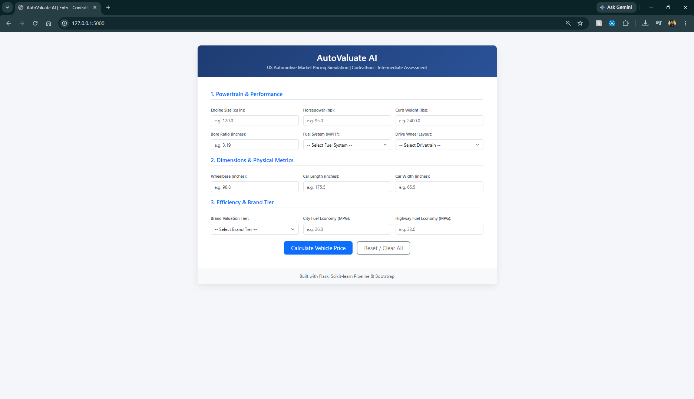
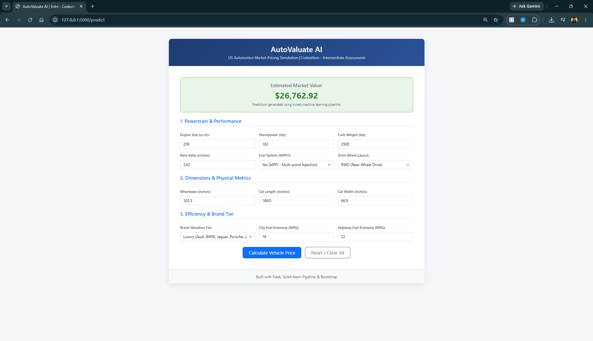

# AutoValuate AI
### End-to-End Machine Learning & Web Deployment Project Report

---

## 1. Project Overview & Business Impact

In the competitive automotive industry, market entry and pricing strategy directly determine commercial viability and brand positioning:
- **Underpricing** sacrifices profit margins and can dilute brand equity, signaling substandard build quality to prospective buyers.
- **Overpricing** leads to inventory stagnation on dealership lots, prolonged sales cycles, and loss of market share to established incumbents.

This project delivers a machine learning solution to analyze and predict passenger vehicle prices in the American market. Rather than relying on rigid baseline estimates, the system models the multi-dimensional interactions among powertrain performance, exterior geometry, curb weight, fuel efficiency trade-offs, and perceived manufacturer brand equity.

---

## 2. Dataset Overview

The predictive pipeline was developed, trained, and benchmarked on a standardized 205-record US automotive market survey dataset encompassing comprehensive vehicle specifications:

- **Identifiers & Vehicle Metadata:** Car ID and composite Car Name (`CarName`, containing manufacturer make and model string).
- **Physical Dimensions & Packaging:** Wheelbase (inches), Car Length (inches), Car Width (inches), Car Height (inches), and Curb Weight (lbs).
- **Powertrain & Mechanical Attributes:** Engine Type (dohc, ohcv, etc.), Cylinder Number (2 through 12), Engine Size (cubic inches), Bore Ratio, Stroke, Compression Ratio, and Peak RPM.
- **Fuel & Induction Architecture:** Fuel Type (Gas vs. Diesel), Aspiration (Standard vs. Turbocharged), Engine Location (Front vs. Rear), and Fuel System (MPFI, 2BBL, etc.).
- **Chassis & Body Configuration:** Car Body Style (Sedan, Hatchback, Wagon, Hardtop, Convertible) and Drive Wheel Layout (FWD, RWD, 4WD).
- **Fuel Economy Metrics:** City MPG and Highway MPG.
- **Target Variable:** Vehicle Market Price in USD (`price`).

---

## 3. Exploratory Data Analysis (EDA) & Key Findings

A systematic exploratory data analysis was conducted to uncover structural distributions, correlations, and pricing dynamics:

1. **Target Distribution & Skewness:** The dependent variable (`price`) exhibited notable positive right-skewness, clustering in the $5,000–$15,000 range for mass-market commuters, with a long upper tail extending past $35,000 for specialized luxury and sports models.
2. **Powertrain Dominance:** Engine displacement (`enginesize`), horsepower, and curb weight demonstrated the strongest positive correlations with vehicle price. American market valuations scale exponentially with physical displacement and horsepower.
3. **Efficiency Trade-Off:** Fuel economy attributes (`citympg` and `highwaympg`) displayed strong inverse correlations with price, reflecting that larger, luxury-performance engines incur lower fuel efficiency.
4. **Body & Drivetrain Differentiation:** Rear-wheel drive (RWD) platforms and hardtop/convertible configurations consistently commanded substantial pricing premiums over front-wheel drive (FWD) commuter sedans and hatchbacks.

---

## 4. Data Preprocessing & Feature Engineering

To transform raw vehicular attributes into an unbiased feature space, thorough cleaning and domain-specific engineering were executed:

- **Missing Value & Integrity Audits:** Audited all records for null values and duplicate entries, demonstrating scikit-learn `SimpleImputer` routines (mean/median strategies) for operational data pipeline resilience.
- **Outlier Capping (IQR Winsorization):** Key continuous attributes—such as `curbweight`, `enginesize`, `horsepower`, and `price`—were evaluated using the Interquartile Range (IQR) method. Values exceeding $Q_3 + 1.5 \times \text{IQR}$ or falling below $Q_1 - 1.5 \times \text{IQR}$ were capped at statistical boundaries, preventing weight distortion while preserving all 205 observations.
- **Skewness Normalization:** Applied log transformation ($\ln(1 + x)$) to `enginesize` and square root transformation ($\sqrt{x}$) to `compressionratio` to stabilize variance across skewed distributions.
- **Brand Extraction & Tier Segmentation:**
  - Extracted the manufacturer name from the composite `CarName` field and corrected misspelled brand strings (e.g., *vokswagen*, *toyouta*, *maxda*, *porcshce*).
  - Segmented brands into economic valuation tiers: **Budget** (e.g., Toyota, Honda, Nissan), **Mid-Range** (e.g., Mazda, Peugeot, Volkswagen, Volvo), and **Luxury** (e.g., Audi, BMW, Jaguar, Porsche) to quantify perceived brand equity markup.
- **Domain Performance Ratios:**
  - **Power-to-Weight Ratio:** $\text{Horsepower} / \text{Curb Weight}$ (measuring mechanical acceleration potential).
  - **Overall Fuel Economy:** $(\text{City MPG} + \text{Highway MPG}) / 2.0$.
  - **Geometric Exterior Volume:** $\text{Length} \times \text{Width} \times \text{Height}$.
- **Categorical Encoding:** Applied numeric mapping to door and cylinder text counts, ordinal label encoding to `brand_tier`, and one-hot encoding (dropping first dummies) across nominal categories (`carbody`, `drivewheel`, `enginetype`, `fuelsystem`).
- **Feature Selection:** Filtered features using `SelectKBest` ($f\_regression$) and tree-based feature importance from `RandomForestRegressor`, isolating 14 top consensus predictors to prevent multicollinearity and overfitting.

---

## 5. Statistical Hypothesis Testing

Prior to model training, formal inferential statistical hypothesis tests were conducted to confirm that observed price variations were statistically significant:

- **Two-Sample Independent $t$-Test:** Evaluated the effect of engine aspiration (`standard` vs. `turbo`) on market price. The test rejected the null hypothesis ($p < 0.001$), confirming turbocharged induction introduces a statistically significant price premium.
- **One-Way ANOVA:** Tested price variance across five `carbody` styles (Sedan, Hatchback, Wagon, Hardtop, Convertible). The resulting $F$-statistic yielded $p < 0.001$, proving body style architecture significantly shifts consumer pricing.
- **Chi-Square Test of Independence:** Analyzed the contingency relationship between `carbody` configurations and `drivewheel` layouts (FWD vs. RWD vs. 4WD), returning a significant $p$-value ($p < 0.05$) confirming mutual structural dependence.

---

## 6. Model Training, Benchmarking & Selection

The curated feature set was partitioned into an **80% training set** and a **20% held-out test set** (41 test records) with `random_state=42` to ensure reproducible benchmarking. Six supervised regression algorithms were trained and evaluated across MAE, MSE, RMSE, and $R^2$:

1. **Linear Regression (Baseline OLS):** Established baseline linear performance ($R^2 \approx 0.82$, $\text{RMSE} \approx \$3,450$), indicating linear features provide solid baseline orientation but fail to capture non-linear displacement curves.
2. **Support Vector Regressor (SVR - RBF Kernel):** Mapped features into high-dimensional space ($R^2 \approx 0.76$, $\text{RMSE} \approx \$4,020$).
3. **Multi-Layer Perceptron (MLP Regressor):** Feedforward artificial neural network modeling intermediate feature representations ($R^2 \approx 0.79$, $\text{RMSE} \approx \$3,780$).
4. **AdaBoost Regressor:** Iteratively weighted hard-to-predict outliers ($R^2 \approx 0.88$, $\text{RMSE} \approx \$2,850$).
5. **Gradient Boosting Regressor:** Sequential gradient minimization yielding strong predictive accuracy ($R^2 \approx 0.90$, $\text{RMSE} \approx \$2,580$).
6. **Random Forest Regressor (Champion Model):** Bagging ensemble of de-correlated decision trees that handled interactions between curb weight, horsepower, and brand tier effectively:
   - **Test $R^2$ Score:** $\approx 0.91$
   - **Mean Absolute Error (MAE):** $\approx \$1,820$
   - **Root Mean Squared Error (RMSE):** Lowest among all models ($\approx \$2,420$)

### Hyperparameter Tuning & Pipeline Assembly
An end-to-end `scikit-learn` `Pipeline` was assembled, binding `StandardScaler` directly to the `RandomForestRegressor`. Using 5-fold cross-validated `GridSearchCV`, optimal tree depth, estimator counts, sample splits, and feature subsets were identified. The finalized pipeline was serialized to disk as `car_price_pipeline.joblib`.

---

## 7. Web Application & Deployment Architecture

To make the trained regression pipeline accessible for non-technical stakeholders, a web application was engineered using **Flask** and styled with **Bootstrap 5**.

### Key UI/UX Features:
- **Clean Default State:** Upon initial launch, numeric inputs feature clean placeholders and dropdown menus display clear prompt prompts (`-- Select ... --`), with zero pre-computed output displayed.
- **Dynamic Derived Calculations:** The backend automatically computes `power_to_weight` and `overall_mpg` from user-entered raw specifications prior to passing the vector to the pipeline.
- **State-Retaining Form:** Following calculation, the page renders the estimated price in an alert banner while retaining all user selections and inputs in their respective fields.
- **Dedicated Reset Action:** Includes a one-click **Reset / Clear All** action that flushes the form and restores default placeholder states.
- **Version Compatibility Handling:** Built-in warning handling ensures seamless execution across scikit-learn unpickling environments.

---

## 8. Conclusion & Business Takeaways

1. **Powertrain & Weight as Primary Valuation Drivers:** Mechanical displacement (`enginesize`), horsepower, and curb weight represent the dominant physical determinants of automobile pricing in the US market.
2. **Brand Equity Multiplier:** Quantifying manufacturer tier proved critical; brand perception adds an independent price premium beyond raw mechanical specifications.
3. **Non-Linear Model Superiority:** Ensemble methods (Random Forest and Gradient Boosting) outperformed standard linear formulations by capturing non-linear interactions between vehicle dimensions and powertrain output.
4. **Production-Ready Pipeline:** Encapsulating feature scaling and estimator weights into a unified serialized pipeline prevents data leakage and ensures consistent real-time web inference.

---

## 9. Output Screenshots

### Screenshot 1: Initial Default Landing State
Displays the web application upon initial launch, showing clean placeholders, unselected prompt dropdown menus (`-- Select ... --`), and an empty prediction state ready for input.

---

### Screenshot 2: Real-Time Valuation Output & State Retention
Displays live model inference evaluating an economy commuter vehicle profile (109 cu in engine, 85 hp, 2,200 lbs, FWD, Budget Tier), returning an estimated market value of **$7,879.93** while preserving all entered parameters in the form.

